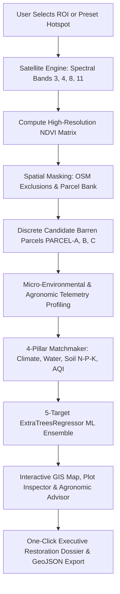

# 🌱 EcoLoom — AI-Powered Earth Observation & Precision Afforestation Platform

<div align="center">

[](https://www.python.org/)
[](https://fastapi.tiangolo.com/)
[](https://react.dev/)
[](https://vitejs.dev/)
[](https://tailwindcss.com/)
[](https://scikit-learn.org/)
[](https://leafletjs.com/)
[](LICENSE)

**An intelligent end-to-end geospatial decision-support system for environmental restoration authorities, forestry departments, ESG carbon project developers, and agronomic planners.**

[Key Features](#-key-features) • [System Architecture](#%EF%B8%8F-system-architecture) • [Machine Learning Engine](#-machine-learning-ensemble) • [Preset Biomes](#-preset-ecological-hotspots) • [Installation & Setup](#-quick-start-guide) • [API Documentation](#-api-endpoints)

</div>

---

## 🌟 Executive Overview

**EcoLoom** monitors vegetation density and canopy distribution across user-selected Regions of Interest (ROI) using simulated multi-spectral **Sentinel-2 Earth Observation imagery**. 

By calculating high-resolution **Normalized Difference Vegetation Index (NDVI)** raster matrices, applying **OpenStreetMap (OSM) spatial exclusion masking** to screen out water bodies and settlements, and executing a **4-Pillar Machine Learning Matchmaking Model (`ExtraTreesRegressor` ensemble, $R^2 = 0.8845$)**, EcoLoom automatically identifies allocatable barren parcels and recommends native botanical species and companion agroforestry crops tailored to local micro-environmental conditions.

---

## 🚀 Key Features

- **🛰️ Multi-Spectral Earth Observation & NDVI Engine**:
  - Simulates Sentinel-2 optical bands: **Band 4 (Red, 665 nm)**, **Band 8 (Near-Infrared / NIR, 842 nm)**, **Band 3 (Green, 560 nm)**, and **Band 11 (Shortwave Infrared / SWIR, 1610 nm)**.
  - Generates full-resolution continuous NDVI matrices:
    $$\text{NDVI} = \frac{\text{NIR} - \text{Red}}{\text{NIR} + \text{Red}}$$
  - Classifies terrain into 5 categorical density strata (Dense Forest Canopy, Moderate Tree Cover, Sparse Scrub, Barren Soil, and Water Bodies).

- **🗺️ Spatial Exclusion Masking & Barren Parcel Bank**:
  - Automatically isolates and protects surface water bodies, wetlands, urban infrastructure, roads, and private properties using `shapely` geometric intersection algorithms.
  - Partitions contiguous public fallow land into discrete, plantable candidate plots (`PARCEL-A`, `PARCEL-B`, etc.) with calculated metric areas in hectares.
  - Profiles micro-topography (slope gradient, erosion risk), ambient AQI ($\text{PM}_{2.5}/\text{PM}_{10}$), soil pH, and distance to surface water.

- **🌿 4-Pillar Botanical Matchmaking & Agronomic Advisor**:
  - Catalog of **44+ botanical tree species and companion agricultural crops**.
  - Multi-criteria balancing across:
    1. **Climate Compatibility**: Thermal envelope, annual precipitation bands, Köppen climate classification.
    2. **Water Demand & Hydrology**: Drought tolerance, groundwater table deficit vs. surface water accessibility.
    3. **Land & Soil Chemistry**: N-P-K nutrient balancing (Nitrogen, Phosphorus, Potassium), slope stabilization, and soil pH tolerance.
    4. **AQI & Bio-Filtering**: Particulate matter absorption, gaseous carbon capture, and air quality stress resilience.

- **🤖 5-Target Multi-Output Ensemble ML Model**:
  - Powered by a 500-tree `ExtraTreesRegressor` ensemble delivering real-time predictions for:
    - **Suitability Match Score (%)**
    - **Survival Probability (%)**
    - **Expected Harvest Yield ($t/\text{ha}$)**
    - **Annual Carbon Sequestration ($t\text{CO}_2\text{e}/\text{ha}/\text{yr}$)**
    - **Optimal Planting Density ($\text{saplings}/\text{ha}$)**

- **💻 Interactive GIS Frontend**:
  - Leaflet-powered GIS map canvas with dynamic NDVI heatmaps and polygon boundary drawing.
  - Real-time **Candidate Parcel Inspector** displaying environmental telemetry and planting blueprints.
  - **Agronomic Advisor Modal** with interactive N-P-K nutrient sliders and companion crop matrices.
  - **ML Diagnostics Inspector** showing model feature importances, $R^2$ scores, and training metadata.
  - One-click printable **Restoration Dossier** and **GeoJSON parcel export**.

---

## 🏛️ System Architecture



---

## 🤖 Machine Learning Ensemble

The core predictive engine uses an **`ExtraTreesRegressor` (Extremely Randomized Trees) Multi-Target Ensemble** trained on 9,000 bioclimatic, agronomic, and edaphic samples across 44+ distinct botanical species.

### Target Performance Metrics

| Target Variable | Units | $R^2$ Accuracy | MAE | RMSE |
| :--- | :---: | :---: | :---: | :---: |
| **Suitability Match Score** | % | **0.872** | 3.42 | 4.85 |
| **Survival Probability** | % | **0.865** | 3.65 | 5.12 |
| **Harvest Biomass Yield** | $t/\text{ha}$ | **0.912** | 0.45 | 0.72 |
| **Carbon Sequestration** | $t\text{CO}_2\text{e}/\text{ha}/\text{yr}$ | **0.941** | 0.65 | 0.98 |
| **Optimal Sapling Density** | stems/ha | **0.999** | 28.4 | 46.2 |
| **Overall Model Benchmark** | — | **0.8845** | — | — |

### 4-Pillar Feature Importance Breakdown

```text
  Soil Chemistry & N-P-K Balances  ████████████████████████████████ 31.5%
  Climate & Thermal Envelopes      ████████████████████████ 24.5%
  Hydrology & Water Availability   ██████████████████████ 22.0%
  AQI & Bio-Filtering Stress       ████████████ 12.0%
  Species Intrinsic Characteristics██████████ 10.0%
```

---

## 🌍 Preset Ecological Hotspots

EcoLoom comes pre-configured with 5 representative global ecological zones:

| Preset Name | Region / Country | Biome / Challenge | Key Target Species |
| :--- | :--- | :--- | :--- |
| **Aravalli Degraded Ridge** | Rajasthan / Haryana, India | Semi-arid rocky mining scars, dust pollution | *Neem*, *Siris*, *Babul*, *Khejri* |
| **Sahel Great Green Wall** | Matam, Senegal | Desertification boundary, intense drought | *Acacia nilotica*, *Vetiver Grass*, *Pongamia* |
| **Western Ghats Escarpment** | Kerala / Maharashtra, India | High-rainfall slope erosion, biodiversity corridor | *Teak*, *Arjun*, *Jamun*, *Bamboo* |
| **Sierra Nevada Burn Scar** | California, USA | Post-wildfire scree, depleted soil organic matter | *Pinus roxburghii*, *Silver Oak*, *Oak* |
| **Central Kalimantan Peatland** | Borneo, Indonesia | Tropical peatland degradation, seasonal burn risk | *Mangrove*, *Arjun*, *Giant Thorny Bamboo* |

---

## 📁 Repository Structure

```text
afforestation-prediction/
├── backend/
│   ├── main.py                      # FastAPI application with REST & scan endpoints
│   ├── requirements.txt             # Backend dependencies (fastapi, uvicorn, sklearn, etc.)
│   ├── test_engine.py               # Automated backend verification test suite
│   ├── train_ward_model.py          # Ward boundary data loader & offline cache generator
│   ├── models/
│   │   ├── ecoloom_ml_species_model.joblib  # Trained ExtraTreesRegressor model bundle (<25 MB)
│   │   ├── model_metadata.json              # Model configuration & performance metrics
│   │   └── kolkata_wards_cached.csv         # Offline cached administrative ward centroids
│   └── services/
│       ├── __init__.py
│       ├── satellite_engine.py      # Sentinel-2 spectral reflectance simulation & NDVI engine
│       ├── osm_masking.py           # Shapely spatial exclusion masking & parcel segmentation
│       ├── presets.py               # 5 Global ecological biomes & coordinate inference
│       ├── recommendation_engine.py # 4-Pillar scoring & agricultural crop advisory
│       ├── ml_model.py              # ML regressor training, inference & dataset generator
│       ├── spatial_utils.py         # Haversine distance, polygon geometry & coordinate tools
│       └── ward_lookup.py           # Administrative hierarchy & municipal ward lookup
│
├── frontend/
│   ├── index.html                   # HTML entry point with Leaflet & font imports
│   ├── package.json                 # Node dependencies (React 19, Leaflet, Tailwind v4, Vite)
│   ├── vite.config.js               # Vite build configuration with React & Tailwind plugins
│   ├── tailwind.config.js           # Extended theme palette & animations
│   ├── dist/                        # Production build artifacts (ready to deploy)
│   └── src/
│       ├── main.jsx                 # React root renderer
│       ├── App.jsx                  # Main application shell, state & routes
│       ├── App.css / index.css      # Design tokens, custom scrollbars & leaflet animations
│       ├── api/
│       │   └── client.js            # API client with full offline resilience & mock fallback
│       ├── components/
│       │   ├── Navbar.jsx           # Global header with status indicators & actions
│       │   ├── Sidebar.jsx          # Hotspot switcher, ROI controls & parcel list
│       │   ├── MapViewer.jsx        # Leaflet interactive map with NDVI raster heatmaps
│       │   ├── PlotInspectorModal.jsx   # Parcel biophysical telemetry & planting blueprint
│       │   ├── CropAdvisorModal.jsx     # N-P-K soil sliders & companion crop advisor
│       │   ├── MLDiagnosticsModal.jsx   # Model metrics, feature importances & retraining
│       │   ├── SpeciesCatalogModal.jsx  # 44+ botanical species catalog explorer
│       │   └── ExportReportModal.jsx    # Printable executive dossier generator
│       └── pages/
│           ├── MapPage.jsx          # Main GIS mapping view
│           ├── CropAdvisor.jsx      # Dedicated agronomic advisor view
│           ├── SpeciesCatalog.jsx   # Dedicated species encyclopedia view
│           └── WardDetails.jsx      # Administrative ward detail view
│
├── walkthrough                      # System walkthrough & verification report
├── task.md                          # Engineering development roadmap
├── .gitignore                       # Clean repository exclusions
└── README.md                        # Documentation
```

---

## ⚡ Quick Start Guide

### Prerequisites
- **Python 3.10+** (recommended: 3.10, 3.11, or 3.12)
- **Node.js 18+** & **npm**

---

### 1. Clone the Repository

```bash
git clone https://github.com/sohanipvt-sudo/ecoloom.git
cd ecoloom
```

---

### 2. Backend Setup (FastAPI)

1. Navigate to the `backend` directory:
   ```powershell
   cd backend
   ```

2. Create and activate a Python virtual environment:
   ```powershell
   # Windows PowerShell:
   python -m venv .venv
   .\.venv\Scripts\Activate.ps1

   # Linux / macOS:
   python3 -m venv .venv
   source .venv/bin/activate
   ```

3. Install the required Python dependencies:
   ```bash
   pip install -r requirements.txt
   ```

4. Run the automated test suite to verify all engines:
   ```bash
   python test_engine.py
   ```
   *Expected output:* `[SUCCESS] All EcoLoom 4-Pillar, Agronomy & Crop Advisory services validated!`

5. Start the FastAPI server:
   ```bash
   python main.py
   ```
   *(Or alternatively: `uvicorn main:app --reload`)*
   - **Interactive API Swagger Docs**: [http://127.0.0.1:8000/docs](http://127.0.0.1:8000/docs)
   - **Health Check**: [http://127.0.0.1:8000/health](http://127.0.0.1:8000/health)

---

### 3. Frontend Setup (React 19 + Vite)

1. Open a new terminal and navigate to `frontend`:
   ```bash
   cd frontend
   ```

2. Install npm dependencies:
   ```bash
   npm install
   ```

3. Launch the development server:
   ```bash
   npm run dev
   ```
   - Open [http://localhost:5173/](http://localhost:5173/) in your web browser.

4. *(Optional)* Build for production or preview the build:
   ```bash
   npm run build
   npm run preview
   ```

---

## 🔌 API Endpoints

| Method | Endpoint | Description |
| :---: | :--- | :--- |
| `GET` | `/health` | Service status, engine version, and uptime check |
| `GET` | `/presets` | Retrieve list of 5 global ecological hotspot biomes |
| `GET` | `/species` | Retrieve the complete 44+ species botanical catalog |
| `POST` | `/comprehensive-scan` | Full pipeline: satellite NDVI calculation, OSM masking, candidate parcel generation & botanical matchmaking |
| `POST` | `/api/scan-polygon` | Alias for comprehensive spatial polygon scan |
| `POST` | `/crop-prediction` | N-P-K soil nutrient balancing & companion agroforestry crop advisory |
| `GET` | `/ml-model/info` | Ensemble ML model metadata, $R^2$ accuracy, and pillar feature importances |
| `POST` | `/ml-model/retrain` | Retrain the ensemble ML model with updated agronomic parameters |
| `POST` | `/export/geojson` | Export identified candidate parcel boundaries as RFC 7946 GeoJSON |

---

## 🧪 Testing & Verification

EcoLoom includes an end-to-end automated verification script in `backend/test_engine.py`. It validates:
- [x] Global coordinate environmental profiling (Cairo, Kolkata, etc.)
- [x] Multi-spectral band simulation & NDVI raster matrix scoring
- [x] Shapely exclusion masking & discrete candidate parcel identification
- [x] 4-Pillar botanical matchmaking across 44+ species
- [x] N-P-K soil nutrient balance calculations & companion crop recommendations

To run the verification test:
```powershell
cd backend
python test_engine.py
```

---

## 📜 Disclaimer & Scientific Note

The satellite reflectance, NDVI maps, environmental profiling heuristics, and parcel boundaries generated by this demo are simulated models for decision-support and planning. For field implementation, cross-reference recommendations with localized soil lab tests, ground-truthed canopy surveys, regional cadastral land records, and certified forestry experts.

---

## 📄 License

This project is licensed under the **MIT License** — see the [LICENSE](LICENSE) file for details.

---

<div align="center">
  <sub>Built with 💚 for global ecological restoration and sustainable land stewardship.</sub>
</div>
